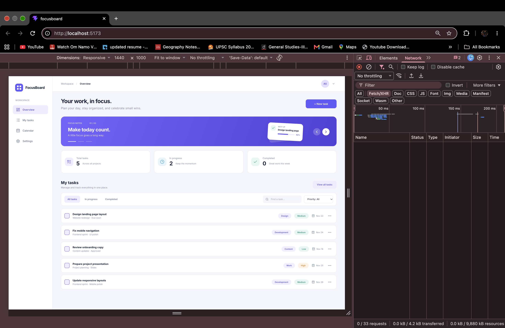
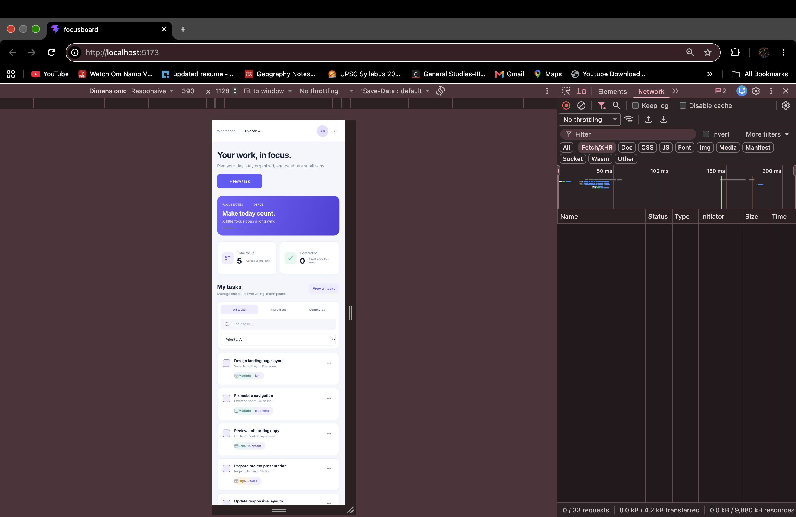
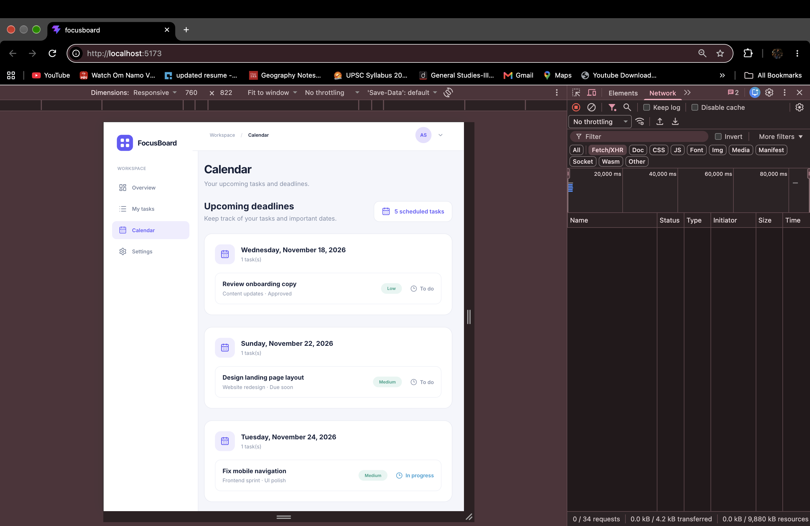
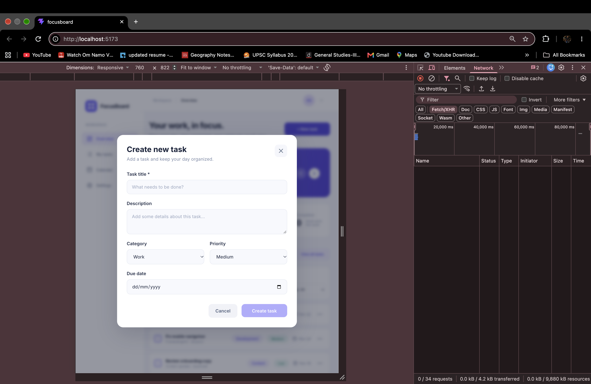

# FocusBoard – Task Management Dashboard

A responsive task management dashboard built with React to help users organize tasks, manage priorities, track deadlines, and monitor productivity.

## Live Application

**Live Demo:** https://focusboard-deployment.vercel.app/

**GitHub Repository:** https://github.com/anandkundurthi/focusboard

## Overview

FocusBoard is a frontend task management application that provides a centralized workspace for creating, organizing, and tracking tasks.

The application includes an overview dashboard, task management workspace, calendar, and settings page. It offers task filtering, progress statistics, persistent browser storage, and responsive layouts for desktop, tablet, and mobile devices.

## Features

- **Dashboard:** Overview of tasks, progress statistics, and Focus Notes carousel.
- **Task management:** Create, view, edit, and delete tasks.
- **Task organization:** Manage task categories, priorities, statuses, and due dates.
- **Search:** Search tasks by title.
- **Filtering:** Filter tasks by status and priority.
- **Dashboard statistics:** Track task counts and completion progress.
- **Calendar:** View scheduled tasks organized by due date.
- **Settings:** Manage profile information and notification preferences.
- **Dynamic profile menu:** Display user initials and saved profile details.
- **Persistent storage:** Preserve tasks and preferences using browser localStorage.
- **Responsive design:** Layouts for desktop, tablet, and mobile devices.
- **Custom dialogs:** Dedicated task creation, editing, and deletion dialogs.

## Tech Stack

| Technology | Purpose |
|---|---|
| React | Component-based user interface |
| Vite | Development server and production build |
| JavaScript | Application logic |
| CSS3 | Styling and responsive layouts |
| React Context API | Shared application state |
| Custom React Hooks | Reusable access to task state |
| Lucide React | Icons |
| Browser localStorage | Local data persistence |

## Application Pages

### Overview
Displays Focus Notes, task statistics, and an overview of task activity.

### My Tasks
Provides a dedicated workspace for viewing, searching, filtering, and managing tasks.

### Calendar
Displays scheduled tasks grouped by their due dates.

### Settings
Provides profile information and notification preference settings.

## State Management

FocusBoard uses the **React Context API** to share task state across components.

A custom `useTasks` hook provides reusable access to the shared task context. React state manages application updates, while `useEffect` synchronizes task data with browser localStorage.

This approach avoids unnecessary prop drilling and keeps task-related state accessible across the application.

## Data Storage

FocusBoard currently uses browser localStorage for persistence.

- Task data is stored locally in the browser.
- Profile and notification preferences are stored locally.
- Data remains available after refreshing the page in the same browser.

There is no backend database or cloud synchronization. Data is not shared across devices or users.

## Screenshots

### Desktop Dashboard



### Mobile Dashboard



### Calendar



### New Task Dialog



## Getting Started

### Prerequisites

- Node.js
- npm
- Git

### Installation

Clone the repository:

```bash
git clone https://github.com/anandkundurthi/focusboard.git
```

Navigate to the project directory:

```bash
cd focusboard
```

Install dependencies:

```bash
npm install
```

Start the development server:

```bash
npm run dev
```

Open the local URL displayed in your terminal.

## Available Commands

| Command | Description |
|---|---|
| `npm run dev` | Start the development server |
| `npm run lint` | Run ESLint checks |
| `npm run build` | Generate the production build |
| `npm run preview` | Preview the production build locally |

## Project Structure

```text
focusboard/
├── public/
├── screenshots/
│   ├── desktop.png
│   ├── mobile.png
│   ├── calendar.png
│   └── newtask.png
├── src/
│   ├── assets/
│   ├── components/
│   │   ├── common/
│   │   ├── dashboard/
│   │   ├── layout/
│   │   └── tasks/
│   ├── context/
│   │   ├── TaskContext.jsx
│   │   └── TaskContextDefinition.js
│   ├── data/
│   ├── hooks/
│   ├── utils/
│   ├── App.jsx
│   ├── App.css
│   ├── index.css
│   └── main.jsx
├── AI_USAGE.md
├── index.html
├── package.json
└── README.md
```

## Quality Checks

The application was validated using:

```bash
npm run lint
npm run build
```

Both checks completed successfully during development.

The application was also tested across desktop, tablet, and mobile screen sizes, and its main task management functionality was manually verified.

## Limitations

- Task and preference data are stored locally in the browser.
- No backend API or database integration.
- No user authentication or multi-user functionality.
- No cloud synchronization between devices.
- Notifications are limited to the implemented frontend preferences.

## Future Improvements

- Backend API integration.
- User authentication.
- Cloud database synchronization.
- Real task reminders and notifications.
- Drag-and-drop task organization.
- Advanced calendar views.

## AI Usage Disclosure

See [AI_USAGE.md](AI_USAGE.md) for details about AI tools used, AI-assisted development areas, representative prompts, human review, and corrections made during development.

## License

This project is available for educational and portfolio purposes. Add a license file if you intend to distribute it under a specific open-source license.